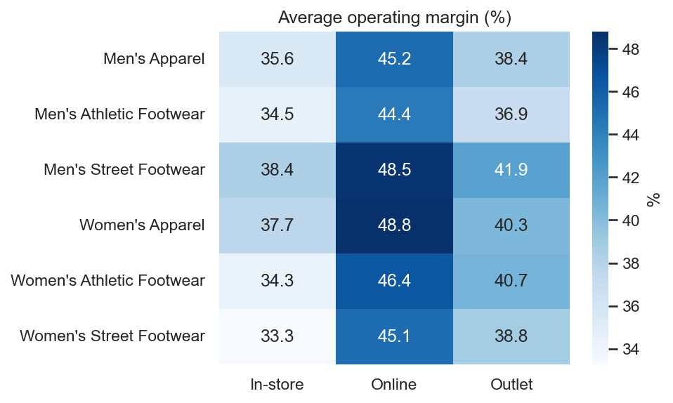
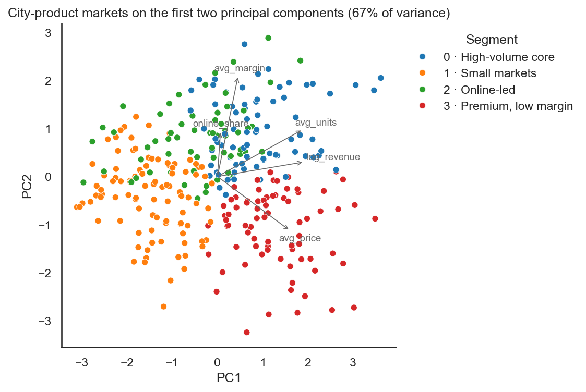
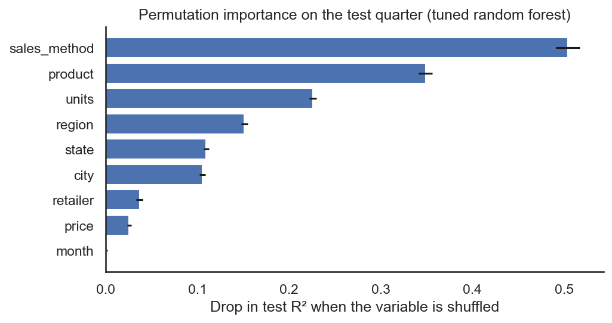

# Adidas US sales: data audit, market segmentation and margin drivers

Invoice-level sales of Adidas products through six US retailers (2020–2021, 9,648 lines).
The project audits the data, segments the city–product markets with K-means and
predicts the **operating margin** of each sale on an unseen quarter.

**Key findings:**

- **40% of the rows overstate sales tenfold.** Rebuilding revenue as price × units cuts
  total sales from $900M to $120M and changes the channel mix: online, not in-store, is
  the largest channel.
- **Channel drives profitability.** Online sales earn the highest margins and in-store the
  lowest; within channels, margins depend on product × location combinations.
- A tuned random forest predicts next-quarter margins with **R² = 0.76** (mean absolute
  error 3.1 percentage points), against 0.49 for an additive ridge model.

## 1. Data audit

Total sales should equal price × units. In 3,886 rows (every in-store sale and a fifth of
online and outlet sales) they are **exactly ten times** that, and operating profit, which
equals sales × margin, inherits the error. The units are not the culprit: the affected
rows have *more* units than the rest, not ten times fewer.

| | Reported | Rebuilt |
|---|---:|---:|
| Total sales | $899.9M | $120.2M |
| Operating profit | $332.1M | $47.2M |
| In-store share of sales | 39.6% | 29.7% |
| Online share of sales | 27.5% | 37.4% |

The margin is a ratio and is not affected, which is one reason to model it instead of profit.



## 2. Market segmentation

Each city–product market is described by its average price, deal size (units per invoice
line), average margin, online share and revenue, standardized and clustered with K-means.
The segmentation is fitted on the training period only, so it can be used as a model
feature without looking at the test quarter.

Silhouette scores are low and flat (0.22–0.25 for 2 to 8 clusters): the markets form a
continuum, so the segments are a summary rather than natural groups. K = 4 scores best:

| Segment | Markets | Profile | Share of revenue |
|---|---:|---|---:|
| High-volume core | 77 | largest deals, highest margin (48.9%) | 35% |
| Premium, low margin | 77 | highest prices ($55), lowest margin (36.1%) | 36% |
| Online-led | 61 | 84% of sales online, margin 43.0% | 17% |
| Small markets | 96 | lowest prices, smallest deals, margin 41.1% | 12% |



## 3. Predicting the operating margin

**Why the margin.** Profit is revenue × margin: predicting it from sales figures mostly
rediscovers that identity (and, with the reported data, the 10× error). The margin is the
part that has to be learned.

**Set-up.** Features: channel, product, retailer, region, state, city, price, units and
month. Train on January 2020 – September 2021 and test once on **October – December 2021**
(2,085 lines). Hyperparameters are tuned with a randomized search over time-ordered folds
of the training period. All preprocessing lives in scikit-learn pipelines fitted on
training data only.

| Model (test: Q4 2021) | R² | MAE (pp) |
|---|---:|---:|
| Training mean | −0.001 | 7.3 |
| Channel × product means | 0.242 | 6.2 |
| Ridge (one-hot, additive) | 0.489 | 5.0 |
| Random forest | 0.732 | 3.3 |
| **Random forest, tuned** | **0.762** | **3.1** |
| Random forest, tuned + segment | 0.755 | 3.0 |

- The jump from ridge to the forest shows that **margins depend on interactions**: the
  same product earns different margins depending on channel and location.
- The market segment adds nothing once the model sees city and product, from which the
  segment is built.
- Part of the importance of *units* reflects the 10× rows, which are larger deals with
  lower margins.



## Reproduce

```bash
pip install -r requirements.txt
jupyter nbconvert --to notebook --execute --inplace notebooks/adidas_sales_profitability.ipynb
pytest
```

The dataset is downloaded with `kagglehub` on the first run; the notebook takes about
two minutes on a laptop.

```
├── src/adidas/         loading and audit, segmentation, margin models
├── notebooks/          end-to-end analysis
├── reports/figures/    figures used in this README
└── tests/              revenue rebuild, segment assignment
```

## Limitations and next steps

- A public dataset of unknown provenance; the 10× fix is supported by the data but cannot
  be checked against the source.
- A single test quarter; a rolling evaluation over several quarters would be more robust.
- Next: shrinkage (hierarchical) estimates for small markets, and confirming the 10× rows
  with the data owner.

## Background

This started as my final project for the AI module of Tokio School's Python, AI and
Machine Learning program, which clustered the markets and predicted operating profit.
This version adds the data audit, models the margin instead of the profit, evaluates out
of time and fits every preprocessing step on training data only.

Data: [Adidas US Sales Dataset](https://www.kaggle.com/datasets/heemalichaudhari/adidas-sales-dataset)
(Kaggle), not stored in this repository.

---

Daniel Garcia Sanchez · [LinkedIn](https://linkedin.com/in/daniel-gsanchez)
